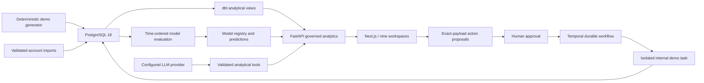

# Architecture

RevPilot is a Next.js workspace backed by FastAPI, PostgreSQL 18, dbt analytical
views, fitted Python models, a bounded provider tool loop and Temporal workflows.
Northstar Cloud is an isolated synthetic tenant. No live company credentials are
required to investigate its records or exercise internal approval flows.

Application database sessions set an organisation context transaction-locally.
The application login is not a superuser; forced row-level security applies to
canonical and operational records. Organisation-scoped foreign keys protect the
commercial fact tables. JSONB operational links also receive API checks; full
typed relational constraints for every operational relationship remain unfinished.

The database owns the raw commercial facts. API calculations never rely on a
separate browser KPI implementation. Historical pipeline snapshots, complete
accounting event history and additional dbt-governed measures remain acceptance
work, tracked explicitly in implementation-status.md.
